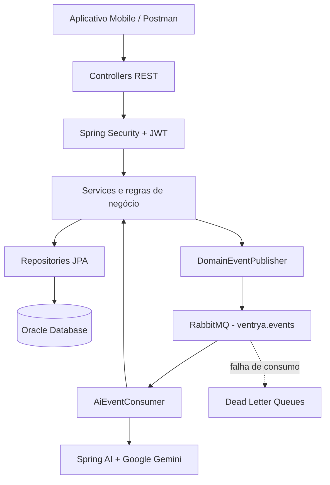
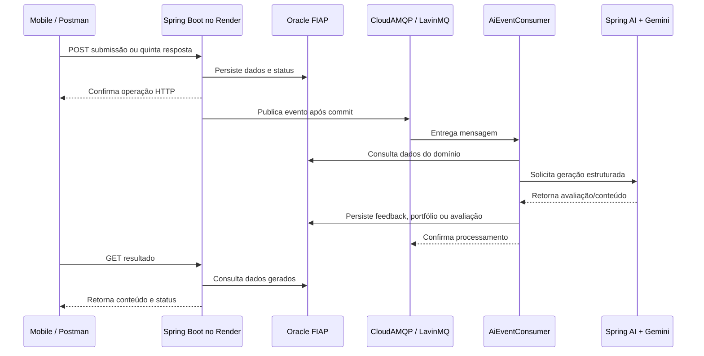

🚀 Ventrya API — Experiência que abre portas
Global Solution 2026/2 · FIAP · Java Advanced · CitizenTech
API REST para empregabilidade jovem: desafios práticos, avaliação com inteligência artificial, portfólio profissional automático e entrevistas simuladas.

📑 Sumário
1. Problema e proposta
2. Tecnologias
3. Arquitetura e processamento assíncrono
4. Modelagem e regras de negócio
5. Autenticação, roles e segurança
6. Endpoints da API
7. Fluxo completo de utilização
8. Como executar localmente
9. Testes e evidências
10. Spring AI e Gemini: inteligência artificial aplicada
11. Deploy no Render e serviços em nuvem
12. Correspondência com os requisitos acadêmicos
🎯 1. Problema e proposta
Jovens em busca do primeiro emprego enfrentam um ciclo recorrente: muitas vagas exigem experiência prévia, mas é difícil adquirir experiência sem uma oportunidade inicial.

A Ventrya propõe uma alternativa: estudantes participam de desafios práticos vinculados a organizações, desenvolvem soluções, recebem feedback estruturado por IA e transformam as entregas em experiências de portfólio. Também podem treinar entrevistas com perguntas de RH e receber avaliação personalizada.

Público-alvo: jovens de 16 a 24 anos em início de carreira. Impacto esperado: ampliar o acesso à prática profissional, à orientação e à preparação para processos seletivos.

Escopo implementado: organizações e desafios previamente cadastrados; candidatura com aprovação automática; submissão única; feedback e portfólio gerados assincronamente; entrevistas simuladas; autenticação e autorização por papéis.
🛠️ 2. Tecnologias
Camada	Tecnologia	Finalidade
Linguagem	Java 21	Desenvolvimento backend
Framework	Spring Boot 4.1.2	API REST e injeção de dependências
Segurança	Spring Security, JWT, BCrypt	Autenticação, autorização e proteção de senhas
Persistência	Spring Data JPA / Hibernate	Entidades e acesso a dados
Banco	Oracle Database	Persistência relacional
Versionamento do schema	Flyway	Migrations SQL
IA	Spring AI 2.0.1 + Google Gemini (Google GenAI)	Feedback, portfólio e entrevistas
Mensageria	Spring AMQP + RabbitMQ, hospedado no CloudAMQP (LavinMQ)	Eventos e consumidores assíncronos
Hospedagem	Render	Deploy público da API
API de IA	Gemini Developer API (gemini-3.5-flash-lite no teste validado)	Inferência remota sem dependência de máquina local
Cliente mobile	React Native + Expo	Consumo da API REST pelo aplicativo da disciplina
Build	Gradle	Dependências e execução
Testes manuais	Postman	Validação funcional e de segurança

Escolha do requisito de arquitetura distribuída: Opção A — RabbitMQ, com publicação e consumo assíncronos. O projeto não depende de microsserviços/Eureka para cumprir essa opção.
🏗️ 3. Arquitetura e processamento assíncrono
A aplicação segue a organização em Controller → Service → Repository, com DTOs de entrada e saída, entidades JPA, configurações de segurança, serviços de IA e componentes de mensageria.

📤 Fluxo de submissão, feedback e portfólio
1. O estudante envia POST /api/submissions para uma candidatura aprovada e válida.
2. A aplicação persiste a submissão com status SUBMITTED.
3. Após o commit da transação, DomainEventPublisher publica submission.created no exchange ventrya.events.
4. A fila ventrya.submission.created entrega o evento ao AiEventConsumer.
5. O consumidor consulta o desafio e a submissão, solicita ao Spring AI uma avaliação e persiste o Feedback (comentário, nota de 1 a 5, pontos fortes e melhorias).
6. Em seguida, o mesmo consumidor utiliza os dados da solução e do feedback para gerar e persistir o PortfolioEntry.
7. O estudante consulta os resultados por endpoints GET autenticados.
Importante: o processamento é assíncrono. O 201 Created da submissão confirma seu registro, não a conclusão imediata da avaliação. Durante o processamento, as consultas de feedback ou portfólio podem retornar 404 até que o registro seja criado.
🎤 Fluxo de entrevista
1. O estudante inicia uma entrevista selecionando a área profissional.
2. A API apresenta cinco perguntas de RH, respondidas sequencialmente.
3. Após a quinta resposta, a entrevista passa a PROCESSING.
4. Após o commit, é publicado interview.completed.
5. O consumidor solicita à IA cinco avaliações individuais e um feedback geral.
6. A entrevista é atualizada para COMPLETED após a persistência do resultado.
🐇 RabbitMQ — exchanges e filas
Componente	Nome
Exchange principal	ventrya.events
Exchange de falhas	ventrya.events.dlx
Routing key de submissão	submission.created
Fila de submissão	ventrya.submission.created
DLQ de submissão	ventrya.submission.created.dead
Routing key de entrevista	interview.completed
Fila de entrevista	ventrya.interview.completed
DLQ de entrevista	ventrya.interview.completed.dead

As filas são duráveis. A configuração desativa reentrega infinita de mensagens rejeitadas; falhas podem encaminhar eventos às Dead Letter Queues (DLQs). O consumidor verifica a existência prévia de feedback/portfólio e o estado da entrevista para reduzir duplicações. Não há endpoint público de reprocessamento de DLQ documentado neste projeto.
🗃️ 4. Modelagem e regras de negócio
Entidades principais
Entidade	Responsabilidade
User	Estudante ou administrador, perfil e credenciais
Organization	Organização vinculada aos desafios
Challenge	Desafio, requisitos, área, dificuldade e prazo
Application	Candidatura de estudante a desafio
Submission	Solução enviada para candidatura
Feedback	Avaliação gerada pela IA
PortfolioEntry	Experiência profissional gerada a partir da solução
Interview	Entrevista simulada e resultado geral
InterviewQuestion	Pergunta, resposta e avaliação individual

Relacionamentos: uma organização possui vários desafios; um desafio possui várias candidaturas; cada candidatura pertence a um estudante e admite no máximo uma submissão; cada submissão admite no máximo um feedback e uma entrada de portfólio. Organizações e usuários também possuem relacionamento por tabela de associação. Uma entrevista pertence a um estudante e contém cinco perguntas.

Migrations: V1 a V10 em src/main/resources/db/migration, incluindo a estrutura de perguntas de entrevista.
Regras essenciais
- Cadastro público atribui STUDENT; não permite escolher ADMIN no corpo da requisição.
- E-mail de usuário deve ser único; senhas são armazenadas com BCrypt.
- O desafio precisa estar OPEN e dentro do prazo para receber candidaturas.
- Cada estudante pode se candidatar uma vez ao mesmo desafio; a candidatura é aprovada automaticamente (APPROVED).
- A submissão exige candidatura própria e aprovada, além de prazo válido.
- A primeira submissão é definitiva: não há endpoint de edição ou exclusão.
- Feedback e portfólio são gerados internamente; o estudante só possui endpoints de consulta.
- O estudante só pode acessar candidaturas, submissões, feedbacks, portfólios e entrevistas que lhe pertencem.
- A entrevista exige cinco respostas em sequência; cada resposta é definitiva, não pode estar vazia e aceita até 4.000 caracteres.
🔐 5. Autenticação, roles e segurança
A API usa JWT Bearer, com sessão STATELESS e controle de autorização no SecurityConfig.
Role	Acesso
STUDENT	Candidaturas, submissões, feedbacks, portfólios e entrevistas próprias; consultas de organizações e desafios
ADMIN	GET /api/admin/users (listagem paginada de usuários); consultas de organizações e desafios; consulta ao próprio perfil
ORGANIZATION	Reservada para possível evolução; não é uma role operacional implementada

O perfil ADMIN não herda as permissões de STUDENT. Assim, uma tentativa de acesso de administrador a /api/portfolios/me retorna 403 Forbidden.

Rotas públicas: POST /api/auth/register e POST /api/auth/login. Rotas autenticadas para ambos os papéis: /api/users/me, /api/organizations/** e /api/challenges/**.

Rotas exclusivas de STUDENT: /api/applications/**, /api/submissions/**, /api/feedbacks/**, /api/portfolios/**, /api/interviews/**.

Rota exclusiva de ADMIN: /api/admin/** (endpoint implementado: GET /api/admin/users). Demais rotas não autorizadas são bloqueadas por padrão.

Conta administrativa: o cadastro público atribui exclusivamente o papel STUDENT. O perfil ADMIN é provisionado de forma controlada no banco de dados, sem endpoint público para elevação de privilégios. Após a definição do papel, a autenticação emite um JWT com as permissões correspondentes.
Códigos HTTP principais
Status	Significado
200 OK	Consulta, login ou atualização de resposta concluída
201 Created	Cadastro, candidatura, submissão ou entrevista criada
400 Bad Request	Dados inválidos ou regra de validação violada, conforme o caso
401 Unauthorized	Autenticação ausente ou inválida
403 Forbidden	Usuário autenticado sem o papel exigido ou sem autorização
404 Not Found	Recurso inexistente ou resultado assíncrono ainda não disponível
409 Conflict	Conflito de regra de negócio, como candidatura duplicada, conforme o tratamento aplicado

O SecurityConfig permite o despacho interno de erros (DispatcherType.ERROR), evitando mascarar respostas 404 como 401.
🌐 6. Endpoints da API
Base URL local: http://localhost:8080. Base URL pública: https://ventryaapi.onrender.com.

Autorização: em rotas protegidas, enviar Authorization: Bearer <JWT>.

Paginação: endpoints que retornam Page<T> aceitam parâmetros como ?page=0&size=10.
🔑 Autenticação e usuários
Método	Endpoint	Acesso	Descrição
POST	/api/auth/register	Público	Cadastrar estudante
POST	/api/auth/login	Público	Autenticar e obter JWT
GET	/api/users/me	Autenticado	Consultar perfil próprio
GET	/api/admin/users	ADMIN	Listar usuários com paginação

🏢 Organizações e desafios
Método	Endpoint	Acesso	Descrição
GET	/api/organizations	Autenticado	Listar organizações, paginado
GET	/api/organizations/{id}	Autenticado	Consultar organização
GET	/api/challenges	Autenticado	Listar desafios, paginado
GET	/api/challenges/{id}	Autenticado	Consultar desafio
GET	/api/challenges/area/{professionalArea}	Autenticado	Filtrar desafios por área, paginado
GET	/api/challenges/organization/{organizationId}	Autenticado	Filtrar desafios por organização, paginado

Áreas aceitas: TECHNOLOGY, ADMINISTRATION, MARKETING, DESIGN, FINANCE, OTHER.

Escopo dos catálogos: organizações e desafios são disponibilizados para consulta e filtragem. Os registros demonstrativos são previamente cadastrados no banco de dados. As operações de candidatura e submissão são disponibilizadas por endpoints próprios.
📝 Candidaturas e submissões
Método	Endpoint	Acesso	Descrição
POST	/api/applications/challenge/{challengeId}	STUDENT	Candidatar-se a desafio
GET	/api/applications/me	STUDENT	Listar candidaturas próprias, paginado
GET	/api/applications/{id}	STUDENT	Consultar candidatura própria
POST	/api/submissions	STUDENT	Enviar solução
GET	/api/submissions/{id}	STUDENT	Consultar submissão própria
GET	/api/submissions/application/{applicationId}	STUDENT	Consultar submissão por candidatura

🤖 Feedbacks e portfólios
Método	Endpoint	Acesso	Descrição
GET	/api/feedbacks/{id}	STUDENT	Consultar feedback
GET	/api/feedbacks/submission/{submissionId}	STUDENT	Consultar feedback de uma entrega
GET	/api/portfolios/me	STUDENT	Listar portfólios próprios, paginado
GET	/api/portfolios/{id}	STUDENT	Consultar portfólio
GET	/api/portfolios/submission/{submissionId}	STUDENT	Consultar portfólio de uma entrega

🎤 Entrevistas simuladas
Método	Endpoint	Acesso	Descrição
POST	/api/interviews	STUDENT	Iniciar entrevista
GET	/api/interviews/me	STUDENT	Listar entrevistas próprias, paginado
GET	/api/interviews/{id}	STUDENT	Consultar perguntas, status e avaliação
POST	/api/interviews/{interviewId}/questions/{questionNumber}/answer	STUDENT	Responder pergunta específica

Status: IN_PROGRESS → PROCESSING → COMPLETED. O enum também prevê FAILED, mas o tratamento de falhas do consumidor não garante atualização automática para esse estado.
🔄 7. Fluxo completo de utilização
Os exemplos a seguir usam valores ilustrativos. IDs reais devem ser obtidos nas respostas do ambiente utilizado.
Etapa 1 — Cadastrar estudante
POST /api/auth/register — sem token:
{
  "name": "Estudante Exemplo",
  "email": "estudante.exemplo@example.com",
  "password": "SenhaExemplo123!",
  "professionalArea": "TECHNOLOGY"
}
Esperado: 201 Created, com resposta de autenticação conforme o DTO AuthResponse.
Etapa 2 — Fazer login
POST /api/auth/login — sem token:
{
  "email": "estudante.exemplo@example.com",
  "password": "SenhaExemplo123!"
}
Resposta: 200 OK, com o campo token utilizado no cabeçalho Bearer das requisições autenticadas.
Etapa 3 — Consultar o perfil e os desafios
GET /api/users/me
GET /api/organizations?page=0&size=10
GET /api/challenges?page=0&size=10
GET /api/challenges/area/TECHNOLOGY?page=0&size=10
GET /api/challenges/1
Essas requisições exigem JWT. A candidatura depende da seleção de um desafio existente, com status OPEN e prazo vigente.
Etapa 4 — Candidatar-se
POST /api/applications/challenge/1
Authorization: Bearer <STUDENT_TOKEN>
Body: nenhum. Resposta: 201 Created, com status: "APPROVED". O identificador retornado referencia a candidatura nas etapas seguintes.
Etapa 5 — Enviar a solução
POST /api/submissions — Bearer STUDENT:
{
  "applicationId": 3,
  "description": "Desenvolvi uma API REST utilizando Java e Spring Boot, com autenticação JWT, persistência de dados e endpoints para gerenciamento de recursos.",
  "fileUrl": "https://github.com/exemplo/ventrya-solucao"
}
Resposta: 201 Created, com status: "SUBMITTED". O identificador retornado permite consultar a submissão e seus resultados.
Etapa 6 — Acompanhar o processamento da IA
Após a submissão, o RabbitMQ entrega o evento ao consumidor, que gera feedback e portfólio. As respostas podem levar algum tempo, pois dependem do consumo da fila e da resposta da API Gemini.
GET /api/submissions/3
GET /api/feedbacks/submission/3
GET /api/portfolios/submission/3
GET /api/portfolios/me?page=0&size=10
O feedback inclui comment, rating, strengths e improvements. O portfólio inclui title, generatedDescription, skills e status, além dos identificadores e datas.
Etapa 7 — Realizar entrevista simulada
POST /api/interviews — Bearer STUDENT:
{
  "professionalArea": "TECHNOLOGY"
}
Esperado: 201 Created. Consulte o id e as perguntas na resposta.

Para cada pergunta, respeitando a ordem de 1 a 5:
POST /api/interviews/{interviewId}/questions/1/answer
Authorization: Bearer <STUDENT_TOKEN>
Content-Type: application/json
{
  "answer": "Eu organizo minhas tarefas por prioridade e procuro comunicar riscos e impedimentos à equipe."
}
O mesmo endpoint é utilizado para as perguntas 2, 3, 4 e 5, respeitando a sequência. Após a quinta resposta, o resultado fica disponível para consulta:
GET /api/interviews/{interviewId}
GET /api/interviews/me?page=0&size=10
Quando o processamento assíncrono é concluído, o status passa a COMPLETED e a resposta inclui as cinco avaliações e o feedback geral.
Etapa 8 — Demonstrar o ADMIN
A conta administrativa é provisionada previamente no banco, sem cadastro público para esse papel. O login dessa conta emite um JWT de administrador.
GET /api/users/me
Authorization: Bearer <ADMIN_TOKEN>

GET /api/admin/users?page=0&size=10
Authorization: Bearer <ADMIN_TOKEN>
Esperado: perfil com role: "ADMIN" e listagem paginada de usuários no endpoint administrativo.

Teste de restrição:
GET /api/portfolios/me
Authorization: Bearer <ADMIN_TOKEN>
Esperado: 403 Forbidden. Com JWT STUDENT, a mesma rota deve retornar 200 OK para o estudante autenticado.
💻 8. Como executar localmente
Pré-requisitos
- JDK 21 e Gradle Wrapper (incluído no repositório);
- acesso a um banco Oracle compatível, com credenciais válidas;
- acesso a um broker AMQP (CloudAMQP/LavinMQ ou RabbitMQ local);
- chave da Gemini Developer API com acesso ao modelo configurado;
- Git, Postman e conexão com a internet.
A versão implantada utiliza Gemini na nuvem. Não é necessário instalar Ollama, manter o computador ligado ou criar um Cloudflare Tunnel.

1. Clonar o projeto
git clone URL_DO_REPOSITORIO
cd ventrya-api
Execute os comandos a partir da pasta que contém build.gradle e gradlew.
2. Configurar Oracle, Gemini, JWT e RabbitMQ
Configure as variáveis de ambiente na sua IDE, no terminal ou em um arquivo local não versionado. O projeto lê as configurações por meio do application.properties.
Variável	Obrigatória	Descrição
DB_URL	Recomendada	JDBC do Oracle; padrão do projeto: jdbc:oracle:thin:@oracle.fiap.com.br:1521:orcl
DB_USERNAME	Sim	Usuário Oracle
DB_PASSWORD	Sim	Senha Oracle
JWT_SECRET	Sim	Chave segura de assinatura dos tokens JWT
GEMINI_API_KEY	Sim	Chave criada no Google AI Studio
GEMINI_MODEL	Não	Modelo Gemini; padrão recomendado no ambiente validado: gemini-3.5-flash-lite
RABBITMQ_URL	Sim para CloudAMQP	URI AMQP/AMQPS completa, incluindo usuário, senha, host e virtual host
PORT	Não	Porta HTTP; padrão local 8080, Render 10000
CORS_ALLOWED_ORIGINS	Apenas para clientes web	Origens permitidas para navegador/Expo Web; Expo nativo não depende de CORS

Configuração de referência das propriedades da aplicação:
server.port=${PORT:8080}
server.address=0.0.0.0

spring.datasource.url=${DB_URL:jdbc:oracle:thin:@oracle.fiap.com.br:1521:orcl}
spring.datasource.username=${DB_USERNAME}
spring.datasource.password=${DB_PASSWORD}
spring.datasource.driver-class-name=oracle.jdbc.OracleDriver

spring.rabbitmq.addresses=${RABBITMQ_URL:amqp://localhost:5672}
spring.rabbitmq.listener.simple.default-requeue-rejected=false

spring.ai.model.chat=google-genai
spring.ai.google.genai.api-key=${GEMINI_API_KEY}
spring.ai.google.genai.chat.options.model=${GEMINI_MODEL:gemini-3.5-flash-lite}
spring.ai.google.genai.chat.options.temperature=0.2

app.jwt.secret=${JWT_SECRET}
As credenciais do Oracle, a chave JWT, a chave da Gemini Developer API e a URI AMQPS são armazenadas como variáveis de ambiente e não fazem parte do código versionado. O serviço Gemini está sujeito a limites de cota e às condições do plano contratado.

Broker local (opcional): caso não utilize CloudAMQP, inicie um RabbitMQ local compatível com a URL configurada. Exemplo com Docker:
docker run -d --name ventrya-rabbitmq -p 5672:5672 -p 15672:15672 rabbitmq:3-management
No ambiente local, a variável RABBITMQ_URL aponta para o broker escolhido. A administração da instância CloudAMQP utilizada no deploy é realizada pelo LavinMQ Manager.
3. Executar a API
Windows (PowerShell):
.\gradlew.bat bootRun
Linux/macOS:
./gradlew bootRun
Base URL local: http://localhost:8080. Base URL pública: https://ventryaapi.onrender.com.

O Flyway valida/aplica as migrations e o Hibernate utiliza ddl-auto=validate. Sem acesso ao Oracle, a aplicação pode não concluir a inicialização.
4. Testar no Postman
As requisições podem ser realizadas com baseUrl=http://localhost:8080 no ambiente local ou baseUrl=https://ventryaapi.onrender.com no deploy. A coleção de testes utiliza identificadores de desafios, candidaturas, submissões e entrevistas, além de tokens JWT para as rotas protegidas.
🧪 9. Testes e evidências
Testes funcionais do ambiente publicado
O backend foi implantado em https://ventryaapi.onrender.com e testado pelo Postman. Foram observados:
Cenário	Evidência/resultado
Conexão com Oracle FIAP	Pool JDBC conectado; Flyway validou 11 migrations no deploy
Autenticação JWT	Login e acesso a endpoints protegidos via Bearer Token
Candidatura a desafio	Criação no Render sem erro relatado
Criação de entrevista	POST /api/interviews retornou 201 Created
Respostas de entrevista	Cinco respostas enviadas; entrevista alcançou COMPLETED após processamento
Mensageria na nuvem	LavinMQ exibiu 4 filas, 2 consumers e conexão ativa
IA em entrevistas	Avaliação concluída usando Spring AI + Gemini
IA em submissões	Feedback e portfólio gerados e consultados com sucesso após a migração para Gemini
Tratamento de falhas	Mensagens rejeitadas foram observadas na DLQ durante diagnóstico de modelo indisponível; erro corrigido após troca de modelo

Os contadores das filas variam conforme o tráfego. A conclusão do processamento foi verificada pela persistência de feedbacks, portfólios e avaliações e pelo status COMPLETED das entrevistas.
Cenários de validação funcional e de segurança
A validação da API abrange autenticação por JWT, permissões STUDENT e ADMIN, paginação, candidatura única por desafio, bloqueio de submissões duplicadas, geração assíncrona de feedback e portfólio e avaliação de entrevistas com cinco perguntas.

Também foram considerados cenários de erro, incluindo credenciais inválidas, dados obrigatórios ausentes, acesso a recursos de terceiros, desafios fora do prazo e mensagens rejeitadas pelo consumidor RabbitMQ. O tratamento de falhas é realizado pela camada de validação, pelo tratamento global de exceções e, no processamento assíncrono, pelas filas de dead-letter.
🤖 10. Spring AI e Gemini: inteligência artificial aplicada
Objetivo da IA na CitizenTech
A Ventrya utiliza IA generativa para resolver um problema real do público-alvo: a dificuldade de obter orientação e demonstrar competências antes do primeiro emprego. A IA não é um chat genérico independente. Ela participa de processos de negócio existentes, associados a estudantes, desafios, submissões e entrevistas, com resultados persistidos no Oracle e consultáveis pela API.
Tecnologia e integração
- Framework: Spring AI 2.0.1, integrado à aplicação Spring Boot.
- Provedor: Google Gemini Developer API, por meio do starter spring-ai-starter-model-google-genai.
- Modelo validado na implantação: gemini-3.5-flash-lite, selecionado via GEMINI_MODEL (sujeito à disponibilidade para a chave).
- Integração Java: ChatClient.Builder injetado no AiGenerationService, que centraliza a geração dos conteúdos.
- Segurança: a chave GEMINI_API_KEY é lida de variável de ambiente e não é enviada ao cliente Mobile.
- Execução: processamento disparado por eventos RabbitMQ, fora da requisição HTTP de criação.
O projeto utilizou Ollama (qwen2.5:3b) na fase inicial de desenvolvimento. Para a implantação pública, foi migrado para Gemini, eliminando a dependência de um modelo local e de um túnel temporário. Os serviços e os fluxos de negócio permaneceram integrados via Spring AI.
Funcionalidade 1 — Feedback técnico da submissão
Entrada: descrição da solução enviada pelo estudante e informações pertinentes ao desafio.

Processamento: após o evento submission.created, o AiEventConsumer chama AiGenerationService.generateFeedback() via Spring AI/Gemini.

Saída: feedback estruturado e persistido, com comment, rating (1 a 5), strengths e improvements. O estudante consulta o resultado por GET /api/feedbacks/submission/{submissionId}.

Valor para o cidadão: oferece orientação sobre pontos fortes e oportunidades de melhoria, mesmo quando o jovem ainda não possui experiência formal.
Funcionalidade 2 — Portfólio profissional automático
Entrada: solução submetida e feedback produzido na etapa anterior.

Processamento: no fluxo assíncrono da submissão, AiGenerationService.generatePortfolio() gera uma apresentação profissional do trabalho realizado.

Saída: PortfolioEntry persistido, com título, descrição gerada e habilidades identificadas. Consulta por GET /api/portfolios/submission/{submissionId} ou GET /api/portfolios/me.

Valor para o cidadão: transforma uma atividade prática em evidência organizada de competências para processos seletivos.
Funcionalidade 3 — Avaliação de entrevista simulada
Entrada: área profissional e respostas do estudante às cinco perguntas de RH.

Processamento: após a quinta resposta, a entrevista passa para PROCESSING; o evento interview.completed é publicado; o consumer chama AiGenerationService.generateInterviewEvaluation().

Saída: avaliações individuais das cinco respostas, feedback geral e status COMPLETED após persistência. Consulta por GET /api/interviews/{interviewId}.

Valor para o cidadão: possibilita praticar comunicação, argumentação e preparação para entrevistas antes de uma seleção real.
Fluxo técnico completo da IA

Observação: os eventos representam fatos do domínio. O processamento assíncrono evita manter a requisição inicial aguardando a inferência da IA, mas a geração ainda depende de conectividade, cota e disponibilidade do provedor.
Falhas, Dead Letter Queue e limites
- As filas principais possuem consumers e filas mortas associadas: ventrya.submission.created.dead e ventrya.interview.completed.dead.
- Quando uma mensagem é rejeitada, pode ser encaminhada à DLQ para inspeção, sem reentrega infinita.
- Durante os testes, o modelo anterior retornou 404 por indisponibilidade para novos usuários; as mensagens foram encaminhadas à DLQ. A configuração do modelo foi atualizada e os novos fluxos foram concluídos com sucesso.
- Mensagens antigas em DLQ não são reprocessadas automaticamente após corrigir a configuração. Não há endpoint público de reprocessamento documentado.
- As avaliações são apoio orientativo e podem conter imprecisões; não representam certificação de competências nem decisão automatizada de contratação.
- Evite inserir dados pessoais desnecessários nas descrições submetidas à IA. A API envia ao provedor externo o conteúdo necessário para gerar as respostas.
Declaração de uso de inteligência artificial
IA como funcionalidade do produto: o projeto integra Spring AI com Google Gemini para gerar feedback de submissões, entradas de portfólio e avaliações de entrevistas simuladas, como parte do fluxo da solução CitizenTech.

IA como ferramenta de apoio ao desenvolvimento: ferramentas de IA generativa foram utilizadas para auxiliar na investigação de erros, na revisão de configurações e no aprimoramento da documentação. A implementação, a integração dos serviços, os testes e as decisões técnicas permaneceram sob responsabilidade dos desenvolvedores.
☁️ 11. Deploy no Render e serviços em nuvem
Endereços
Serviço	Endereço ou acesso
API pública	https://ventryaapi.onrender.com
Swagger UI	https://ventryaapi.onrender.com/swagger-ui/index.html
OpenAPI JSON	https://ventryaapi.onrender.com/v3/api-docs
Banco	Oracle Database FIAP (credenciais privadas)
Broker	CloudAMQP, instância VentryaApi, administrada pelo LavinMQ Manager
IA	Google Gemini Developer API, acessada pelo Spring AI

Configuração de deploy
1. O repositório GitHub é conectado ao Render Web Service.
2. O Render compila e executa o backend Java 21 por meio da configuração de build/Docker do repositório.
3. As variáveis de ambiente são cadastradas no Render: DB_URL, DB_USERNAME, DB_PASSWORD, JWT_SECRET, RABBITMQ_URL, GEMINI_API_KEY, GEMINI_MODEL e PORT=10000.
4. O Spring Boot escuta em 0.0.0.0 na porta fornecida por PORT.
5. Durante a inicialização, a API valida o schema com Flyway, estabelece a conexão com Oracle e registra as filas/consumers do broker.
6. Após o serviço ficar Live, a API pode ser consumida por Postman e pelo aplicativo Mobile via HTTPS.
O ambiente utiliza CloudAMQP/LavinMQ como broker AMQP compatível com RabbitMQ. O backend publica eventos no exchange ventrya.events, e os consumers recebem as mensagens das filas de submissão e entrevista. O broker e a API estão hospedados separadamente, caracterizando comunicação distribuída assíncrona (opção A do requisito 5).
Integração com React Native + Expo
No app Mobile, configure a base da API como https://ventryaapi.onrender.com e utilize fetch ou outro cliente HTTP para autenticação e consumo dos endpoints. Envie o JWT no cabeçalho Authorization: Bearer <token> nas operações protegidas. No Expo nativo (Android/iOS), CORS não costuma ser necessário; no Expo Web, configure as origens autorizadas do navegador.

A API pública utiliza HTTPS e autenticação JWT, permitindo o consumo pelo aplicativo React Native/Expo e por clientes REST como o Postman. Os testes de backend relatados neste documento foram executados pelo Postman.
Swagger/OpenAPI
A documentação da API é organizada segundo o padrão OpenAPI/Swagger, com rotas de consulta ao contrato e interface de exploração de endpoints. A disponibilidade pública dessas páginas depende da configuração ativa do serviço implantado.
📦 12. Correspondência com os requisitos acadêmicos
A implementação da Ventrya foi organizada em torno dos seis eixos de avaliação da disciplina Java Advanced:
Eixo	Aplicação na Ventrya
API REST e persistência	Entidades relacionadas com Spring Data JPA, Oracle Database, operações REST e consultas paginadas
Validação e erros	Bean Validation nos DTOs e tratamento centralizado com @RestControllerAdvice
Segurança	Spring Security, JWT, BCrypt e autorização por papéis STUDENT e ADMIN
Inteligência artificial	Spring AI e Google Gemini integrados à avaliação de entregas, portfólio e entrevistas
Arquitetura distribuída	Opção A: mensageria RabbitMQ, com publicação e consumo assíncronos, exchanges, filas e DLQs
Documentação e integração	Contrato REST, documentação OpenAPI/Swagger, instruções de execução, deploy HTTPS e interface de consumo para Mobile

O domínio contém nove entidades principais relacionadas. Os endpoints de organizações e desafios apresentados nesta documentação são de leitura, enquanto as operações de criação de candidaturas, submissões e entrevistas são disponibilizadas por rotas específicas. Dessa forma, a documentação distingue o escopo efetivamente exposto pela API de um CRUD genérico para todas as entidades.
Acesso para avaliação
Recurso	Endereço
API publicada	https://ventryaapi.onrender.com
Swagger UI	https://ventryaapi.onrender.com/swagger-ui/index.html
Especificação OpenAPI	https://ventryaapi.onrender.com/v3/api-docs

Usuário STUDENT: uma conta de avaliação pode ser criada por POST /api/auth/register, seguida de autenticação em POST /api/auth/login. O cadastro público atribui o papel STUDENT.

Usuário ADMIN de demonstração:
- Nome: User PostmanADMIN
- E-mail: admin.postman@example.com
- Papel: ADMIN
- Autenticação: POST /api/auth/login com o e-mail acima e a senha definida para a conta de demonstração.
O perfil administrativo é provisionado diretamente no banco, pois o cadastro público cria apenas usuários STUDENT. A senha não é disponibilizada no repositório.

Dados demonstrativos: o banco contém organizações e desafios fictícios, identificados como dados de demonstração, com oportunidades em diferentes áreas profissionais. O catálogo permite testar os fluxos de candidatura, entrega e geração de resultados com IA.
Declaração de uso de IA
A Ventrya utiliza IA generativa como funcionalidade integrante do produto, por meio de Spring AI e Google Gemini, para produzir feedbacks de desafios, descrições de portfólio e avaliações de entrevistas. Ferramentas de IA também foram utilizadas como apoio à análise técnica e à documentação durante o desenvolvimento. As decisões de arquitetura, implementação e validação são de responsabilidade dos desenvolvedores.
Ventrya — experiência que abre portas.
