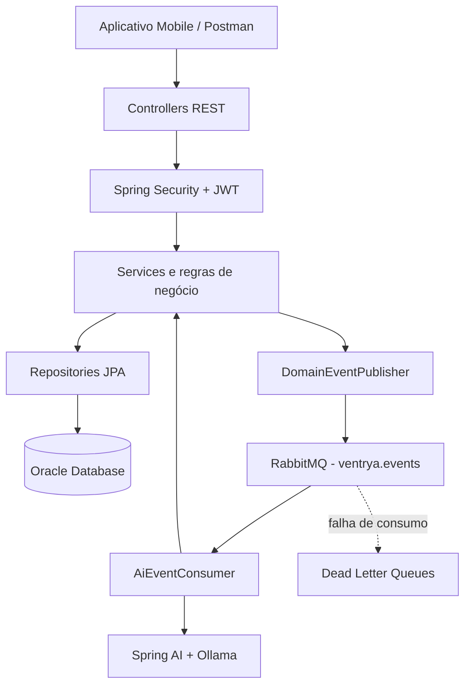

# 🚀 Ventrya API — Experiência que abre portas

**Global Solution 2026/2 · FIAP · Java Advanced · CitizenTech**

> API REST para empregabilidade jovem: desafios práticos, avaliação com inteligência artificial, portfólio profissional automático e entrevistas simuladas.

## 📑 Sumário

1. [Problema e proposta](#-1-problema-e-proposta)
2. [Tecnologias](#-2-tecnologias)
3. [Arquitetura e processamento assíncrono](#-3-arquitetura-e-processamento-assíncrono)
4. [Modelagem e regras de negócio](#-4-modelagem-e-regras-de-negócio)
5. [Autenticação, roles e segurança](#-5-autenticação-roles-e-segurança)
6. [Endpoints da API](#-6-endpoints-da-api)
7. [Fluxo completo de utilização](#-7-fluxo-completo-de-utilização)
8. [Como executar localmente](#-8-como-executar-localmente)
9. [Testes e evidências](#-9-testes-e-evidências)
10. [Documentação e entrega](#-10-documentação-e-entrega)

## 🎯 1. Problema e proposta

Jovens em busca do primeiro emprego enfrentam um ciclo recorrente: muitas vagas exigem experiência prévia, mas é difícil adquirir experiência sem uma oportunidade inicial.

A **Ventrya** propõe uma alternativa: estudantes participam de desafios práticos vinculados a organizações, desenvolvem soluções, recebem feedback estruturado por IA e transformam as entregas em experiências de portfólio. Também podem treinar entrevistas com perguntas de RH e receber avaliação personalizada.

**Público-alvo:** jovens de 16 a 24 anos em início de carreira. **Impacto esperado:** ampliar o acesso à prática profissional, à orientação e à preparação para processos seletivos.

**Escopo implementado:** organizações e desafios previamente cadastrados; candidatura com aprovação automática; submissão única; feedback e portfólio gerados assincronamente; entrevistas simuladas; autenticação e autorização por papéis.

## 🛠️ 2. Tecnologias

| Camada | Tecnologia | Finalidade |
|---|---|---|
| Linguagem | Java 21 | Desenvolvimento backend |
| Framework | Spring Boot 4.1.2 | API REST e injeção de dependências |
| Segurança | Spring Security, JWT, BCrypt | Autenticação, autorização e proteção de senhas |
| Persistência | Spring Data JPA / Hibernate | Entidades e acesso a dados |
| Banco | Oracle Database | Persistência relacional |
| Versionamento do schema | Flyway | Migrations SQL |
| IA | Spring AI 2.0.1 + Ollama (`qwen2.5:3b`) | Feedback, portfólio e entrevistas |
| Mensageria | Spring AMQP + RabbitMQ | Eventos e consumidores assíncronos |
| Build | Gradle | Dependências e execução |
| Testes manuais | Postman | Validação funcional e de segurança |

**Escolha do requisito de arquitetura distribuída:** **Opção A — RabbitMQ**, com publicação e consumo assíncronos. O projeto não depende de microsserviços/Eureka para cumprir essa opção.

## 🏗️ 3. Arquitetura e processamento assíncrono

A aplicação segue a organização em **Controller → Service → Repository**, com DTOs de entrada e saída, entidades JPA, configurações de segurança, serviços de IA e componentes de mensageria.



### 📤 Fluxo de submissão, feedback e portfólio

1. O estudante envia `POST /api/submissions` para uma candidatura aprovada e válida.
2. A aplicação persiste a submissão com status `SUBMITTED`.
3. Após o **commit** da transação, `DomainEventPublisher` publica `submission.created` no exchange `ventrya.events`.
4. A fila `ventrya.submission.created` entrega o evento ao `AiEventConsumer`.
5. O consumidor consulta o desafio e a submissão, solicita ao Spring AI uma avaliação e persiste o **Feedback** (comentário, nota de 1 a 5, pontos fortes e melhorias).
6. Em seguida, o mesmo consumidor utiliza os dados da solução e do feedback para gerar e persistir o **PortfolioEntry**.
7. O estudante consulta os resultados por endpoints GET autenticados.

**Importante:** o processamento é **assíncrono**. O `201 Created` da submissão confirma seu registro, **não** a conclusão imediata da avaliação. Durante o processamento, as consultas de feedback ou portfólio podem retornar `404` até que o registro seja criado.

### 🎤 Fluxo de entrevista

1. O estudante inicia uma entrevista selecionando a área profissional.
2. A API apresenta cinco perguntas de RH, respondidas sequencialmente.
3. Após a quinta resposta, a entrevista passa a `PROCESSING`.
4. Após o commit, é publicado `interview.completed`.
5. O consumidor solicita à IA cinco avaliações individuais e um feedback geral.
6. A entrevista é atualizada para `COMPLETED` após a persistência do resultado.

### 🐇 RabbitMQ — exchanges e filas

| Componente | Nome |
|---|---|
| Exchange principal | `ventrya.events` |
| Exchange de falhas | `ventrya.events.dlx` |
| Routing key de submissão | `submission.created` |
| Fila de submissão | `ventrya.submission.created` |
| DLQ de submissão | `ventrya.submission.created.dead` |
| Routing key de entrevista | `interview.completed` |
| Fila de entrevista | `ventrya.interview.completed` |
| DLQ de entrevista | `ventrya.interview.completed.dead` |

As filas são duráveis. A configuração desativa reentrega infinita de mensagens rejeitadas; falhas podem encaminhar eventos às **Dead Letter Queues (DLQs)**. O consumidor verifica a existência prévia de feedback/portfólio e o estado da entrevista para reduzir duplicações. **Não há endpoint público de reprocessamento de DLQ documentado neste projeto.**

## 🗃️ 4. Modelagem e regras de negócio

### Entidades principais

| Entidade | Responsabilidade |
|---|---|
| `User` | Estudante ou administrador, perfil e credenciais |
| `Organization` | Organização vinculada aos desafios |
| `Challenge` | Desafio, requisitos, área, dificuldade e prazo |
| `Application` | Candidatura de estudante a desafio |
| `Submission` | Solução enviada para candidatura |
| `Feedback` | Avaliação gerada pela IA |
| `PortfolioEntry` | Experiência profissional gerada a partir da solução |
| `Interview` | Entrevista simulada e resultado geral |
| `InterviewQuestion` | Pergunta, resposta e avaliação individual |

**Relacionamentos:** uma organização possui vários desafios; um desafio possui várias candidaturas; cada candidatura pertence a um estudante e admite no máximo uma submissão; cada submissão admite no máximo um feedback e uma entrada de portfólio. Organizações e usuários também possuem relacionamento por tabela de associação. Uma entrevista pertence a um estudante e contém cinco perguntas.

**Migrations:** `V1` a `V10` em `src/main/resources/db/migration`, incluindo a estrutura de perguntas de entrevista.

### Regras essenciais

- Cadastro público atribui `STUDENT`; não permite escolher `ADMIN` no corpo da requisição.
- E-mail de usuário deve ser único; senhas são armazenadas com BCrypt.
- O desafio precisa estar `OPEN` e dentro do prazo para receber candidaturas.
- Cada estudante pode se candidatar **uma vez** ao mesmo desafio; a candidatura é aprovada automaticamente (`APPROVED`).
- A submissão exige candidatura própria e aprovada, além de prazo válido.
- A primeira submissão é **definitiva**: não há endpoint de edição ou exclusão.
- Feedback e portfólio são gerados internamente; o estudante só possui endpoints de consulta.
- O estudante só pode acessar candidaturas, submissões, feedbacks, portfólios e entrevistas que lhe pertencem.
- A entrevista exige cinco respostas em sequência; cada resposta é definitiva, não pode estar vazia e aceita até 4.000 caracteres.

## 🔐 5. Autenticação, roles e segurança

A API usa **JWT Bearer**, com sessão `STATELESS` e controle de autorização no `SecurityConfig`.

| Role | Acesso |
|---|---|
| `STUDENT` | Candidaturas, submissões, feedbacks, portfólios e entrevistas próprias; consultas de organizações e desafios |
| `ADMIN` | `GET /api/admin/users` (listagem paginada de usuários); consultas de organizações e desafios; consulta ao próprio perfil |
| `ORGANIZATION` | Reservada para possível evolução; **não é uma role operacional implementada** |

**Atenção:** `ADMIN` não herda automaticamente `STUDENT`. Por isso, um token ADMIN recebe `403 Forbidden` ao acessar `/api/portfolios/me`, por exemplo.

**Rotas públicas:** `POST /api/auth/register` e `POST /api/auth/login`. **Rotas autenticadas para ambos os papéis:** `/api/users/me`, `/api/organizations/**` e `/api/challenges/**`.

**Rotas exclusivas de STUDENT:** `/api/applications/**`, `/api/submissions/**`, `/api/feedbacks/**`, `/api/portfolios/**`, `/api/interviews/**`.

**Rota exclusiva de ADMIN:** `/api/admin/**` (endpoint implementado: `GET /api/admin/users`). Demais rotas não autorizadas são bloqueadas por padrão.

**Como criar ADMIN para demonstração:** o cadastro público cria somente `STUDENT`. Para o ambiente de testes, um usuário de teste foi criado e seu papel ajustado para `ADMIN` diretamente no banco; em seguida, foi feito **novo login** para obter JWT correspondente. Isso é um procedimento de preparação do ambiente, **não** um endpoint público de promoção de privilégios. Não publique credenciais ou scripts com senhas reais.

### Códigos HTTP principais

| Status | Significado |
|---|---|
| `200 OK` | Consulta, login ou atualização de resposta concluída |
| `201 Created` | Cadastro, candidatura, submissão ou entrevista criada |
| `400 Bad Request` | Dados inválidos ou regra de validação violada, conforme o caso |
| `401 Unauthorized` | Autenticação ausente ou inválida |
| `403 Forbidden` | Usuário autenticado sem o papel exigido ou sem autorização |
| `404 Not Found` | Recurso inexistente ou resultado assíncrono ainda não disponível |
| `409 Conflict` | Conflito de regra de negócio, como candidatura duplicada, conforme o tratamento aplicado |

O `SecurityConfig` permite o despacho interno de erros (`DispatcherType.ERROR`), evitando mascarar respostas `404` como `401`.

## 🌐 6. Endpoints da API

**Base URL local:** `http://localhost:8080`.

**Autorização:** em rotas protegidas, enviar `Authorization: Bearer <JWT>`.

**Paginação:** endpoints que retornam `Page<T>` aceitam parâmetros como `?page=0&size=10`.

### 🔑 Autenticação e usuários

| Método | Endpoint | Acesso | Descrição |
|---|---|---|---|
| POST | `/api/auth/register` | Público | Cadastrar estudante |
| POST | `/api/auth/login` | Público | Autenticar e obter JWT |
| GET | `/api/users/me` | Autenticado | Consultar perfil próprio |
| GET | `/api/admin/users` | ADMIN | Listar usuários com paginação |

### 🏢 Organizações e desafios

| Método | Endpoint | Acesso | Descrição |
|---|---|---|---|
| GET | `/api/organizations` | Autenticado | Listar organizações, paginado |
| GET | `/api/organizations/{id}` | Autenticado | Consultar organização |
| GET | `/api/challenges` | Autenticado | Listar desafios, paginado |
| GET | `/api/challenges/{id}` | Autenticado | Consultar desafio |
| GET | `/api/challenges/area/{professionalArea}` | Autenticado | Filtrar desafios por área, paginado |
| GET | `/api/challenges/organization/{organizationId}` | Autenticado | Filtrar desafios por organização, paginado |

**Áreas aceitas:** `TECHNOLOGY`, `ADMINISTRATION`, `MARKETING`, `DESIGN`, `FINANCE`, `OTHER`.

**Observação:** no código entregue, os Controllers de organizações e desafios disponibilizam **consultas**, não endpoints HTTP de criação, atualização ou exclusão. Os registros são preparados no banco para a demonstração.

### 📝 Candidaturas e submissões

| Método | Endpoint | Acesso | Descrição |
|---|---|---|---|
| POST | `/api/applications/challenge/{challengeId}` | STUDENT | Candidatar-se a desafio |
| GET | `/api/applications/me` | STUDENT | Listar candidaturas próprias, paginado |
| GET | `/api/applications/{id}` | STUDENT | Consultar candidatura própria |
| POST | `/api/submissions` | STUDENT | Enviar solução |
| GET | `/api/submissions/{id}` | STUDENT | Consultar submissão própria |
| GET | `/api/submissions/application/{applicationId}` | STUDENT | Consultar submissão por candidatura |

### 🤖 Feedbacks e portfólios

| Método | Endpoint | Acesso | Descrição |
|---|---|---|---|
| GET | `/api/feedbacks/{id}` | STUDENT | Consultar feedback |
| GET | `/api/feedbacks/submission/{submissionId}` | STUDENT | Consultar feedback de uma entrega |
| GET | `/api/portfolios/me` | STUDENT | Listar portfólios próprios, paginado |
| GET | `/api/portfolios/{id}` | STUDENT | Consultar portfólio |
| GET | `/api/portfolios/submission/{submissionId}` | STUDENT | Consultar portfólio de uma entrega |

### 🎤 Entrevistas simuladas

| Método | Endpoint | Acesso | Descrição |
|---|---|---|---|
| POST | `/api/interviews` | STUDENT | Iniciar entrevista |
| GET | `/api/interviews/me` | STUDENT | Listar entrevistas próprias, paginado |
| GET | `/api/interviews/{id}` | STUDENT | Consultar perguntas, status e avaliação |
| POST | `/api/interviews/{interviewId}/questions/{questionNumber}/answer` | STUDENT | Responder pergunta específica |

**Status:** `IN_PROGRESS` → `PROCESSING` → `COMPLETED`. O enum também prevê `FAILED`, mas o tratamento de falhas do consumidor não garante atualização automática para esse estado.

## 🔄 7. Fluxo completo de utilização

Os exemplos a seguir usam valores ilustrativos. IDs reais devem ser obtidos nas respostas do ambiente utilizado.

### Etapa 1 — Cadastrar estudante

`POST /api/auth/register` — sem token:

```json
{
  "name": "Estudante Exemplo",
  "email": "estudante.exemplo@example.com",
  "password": "SenhaExemplo123!",
  "professionalArea": "TECHNOLOGY"
}
```

**Esperado:** `201 Created`, com resposta de autenticação conforme o DTO `AuthResponse`.

### Etapa 2 — Fazer login

`POST /api/auth/login` — sem token:

```json
{
  "email": "estudante.exemplo@example.com",
  "password": "SenhaExemplo123!"
}
```

**Esperado:** `200 OK`. Guarde o campo `token` da resposta e envie-o como Bearer nos próximos passos.

### Etapa 3 — Consultar o perfil e os desafios

```http
GET /api/users/me
GET /api/organizations?page=0&size=10
GET /api/challenges?page=0&size=10
GET /api/challenges/area/TECHNOLOGY?page=0&size=10
GET /api/challenges/1
```

Essas requisições exigem JWT. Utilize um `challengeId` existente, com status `OPEN` e prazo futuro.

### Etapa 4 — Candidatar-se

```http
POST /api/applications/challenge/1
Authorization: Bearer <STUDENT_TOKEN>
```

**Body:** nenhum. **Esperado:** `201 Created`, com `status: "APPROVED"`. Guarde o `id` retornado como `applicationId`.

### Etapa 5 — Enviar a solução

`POST /api/submissions` — Bearer STUDENT:

```json
{
  "applicationId": 3,
  "description": "Desenvolvi uma API REST utilizando Java e Spring Boot, com autenticação JWT, persistência de dados e endpoints para gerenciamento de recursos.",
  "fileUrl": "https://github.com/exemplo/ventrya-solucao"
}
```

**Esperado:** `201 Created`, com `status: "SUBMITTED"`. Guarde o `id` retornado como `submissionId`.

### Etapa 6 — Acompanhar o processamento da IA

Após a submissão, o RabbitMQ entrega o evento ao consumidor, que gera feedback e portfólio. As respostas podem demorar, dependendo do desempenho local do Ollama.

```http
GET /api/submissions/3
GET /api/feedbacks/submission/3
GET /api/portfolios/submission/3
GET /api/portfolios/me?page=0&size=10
```

O feedback inclui `comment`, `rating`, `strengths` e `improvements`. O portfólio inclui `title`, `generatedDescription`, `skills` e `status`, além dos identificadores e datas.

### Etapa 7 — Realizar entrevista simulada

`POST /api/interviews` — Bearer STUDENT:

```json
{
  "professionalArea": "TECHNOLOGY"
}
```

**Esperado:** `201 Created`. Consulte o `id` e as perguntas na resposta.

Para cada pergunta, respeitando a ordem de 1 a 5:

```http
POST /api/interviews/{interviewId}/questions/1/answer
Authorization: Bearer <STUDENT_TOKEN>
Content-Type: application/json
```

```json
{
  "answer": "Eu organizo minhas tarefas por prioridade e procuro comunicar riscos e impedimentos à equipe."
}
```

Repita para os números `2`, `3`, `4` e `5`, usando respostas apropriadas a cada pergunta. Após a quinta, consulte:

```http
GET /api/interviews/{interviewId}
GET /api/interviews/me?page=0&size=10
```

Aguarde `COMPLETED` para verificar as cinco avaliações e o feedback geral.

### Etapa 8 — Demonstrar o ADMIN

O administrador é preparado previamente no banco, não pelo cadastro público. Faça login com a conta de demonstração ADMIN e obtenha um novo JWT.

```http
GET /api/users/me
Authorization: Bearer <ADMIN_TOKEN>

GET /api/admin/users?page=0&size=10
Authorization: Bearer <ADMIN_TOKEN>
```

**Esperado:** perfil com `role: "ADMIN"` e listagem paginada de usuários no endpoint administrativo.

**Teste de restrição:**

```http
GET /api/portfolios/me
Authorization: Bearer <ADMIN_TOKEN>
```

**Esperado:** `403 Forbidden`. Com JWT STUDENT, a mesma rota deve retornar `200 OK` para o estudante autenticado.

## 💻 8. Como executar localmente

### Pré-requisitos

- JDK 21;
- Docker Desktop para executar o RabbitMQ;
- Ollama instalado, em execução e com o modelo `qwen2.5:3b` disponível;
- acesso a uma instância Oracle compatível, com usuário e senha válidos;
- Gradle Wrapper incluído no projeto.

### 1. Preparar o Ollama

```bash
ollama pull qwen2.5:3b
ollama serve
```

Se o serviço Ollama já estiver em execução, não é necessário iniciar uma segunda instância. A API utiliza `http://localhost:11434`.

### 2. Preparar o RabbitMQ

Exemplo para **primeira criação** do contêiner:

```bash
docker run -d --name ventrya-rabbitmq -p 5672:5672 -p 15672:15672 -e RABBITMQ_DEFAULT_USER=ventrya -e RABBITMQ_DEFAULT_PASS=SENHA_LOCAL_FORTE rabbitmq:3-management
```

Se já existir:

```bash
docker start ventrya-rabbitmq
```

Painel de gerenciamento: `http://localhost:15672` (usuário `ventrya` e senha configurada na criação).

### 3. Configurar variáveis de ambiente

| Variável | Finalidade |
|---|---|
| `DB_URL` | URL JDBC do Oracle |
| `DB_USERNAME` | Usuário do banco |
| `DB_PASSWORD` | Senha do banco |
| `JWT_SECRET` | Segredo de assinatura JWT (valor seguro e compatível com a implementação) |
| `RABBITMQ_HOST` | Host do broker; padrão `localhost` |
| `RABBITMQ_PORT` | Porta AMQP; padrão `5672` |
| `RABBITMQ_USER` | Usuário do broker; padrão `ventrya` |
| `RABBITMQ_PASSWORD` | Senha do broker; obrigatória |

**Nunca versionar segredos reais.** Configure-os no IntelliJ ou no ambiente do processo que inicia a aplicação.

> **Configuração atual:** o arquivo `application.properties` fixa `spring.ai.ollama.chat.options.model=qwen2.5:3b` e `spring.ai.ollama.base-url=http://localhost:11434`. Há também uma propriedade residual de modelo OpenAI, mas o `build.gradle` inclui o starter do **Ollama**, não o starter OpenAI. Não é necessário configurar `OPENAI_API_KEY` para o fluxo atual.

### 4. Iniciar a API

Na pasta interna do projeto que contém `build.gradle` e `gradlew.bat`:

**Windows (PowerShell):**

```powershell
.\gradlew.bat bootRun
```

**Linux/macOS:**

```bash
./gradlew bootRun
```

**API local:** `http://localhost:8080`.

O Flyway aplica as migrations configuradas e o Hibernate está definido com `ddl-auto=validate`, verificando a compatibilidade das entidades com o schema. O acesso ao Oracle é necessário para inicialização bem-sucedida.

### 5. Testar com Postman

Crie um ambiente com `baseUrl=http://localhost:8080`, `studentToken`, `adminToken`, `challengeId`, `applicationId` e `submissionId`. Para endpoints protegidos, escolha o token correspondente ao papel exigido.

## 🧪 9. Testes e evidências

### Testes funcionais realizados no fluxo principal

| Cenário | Resultado observado |
|---|---|
| Login do estudante e identificação do perfil | Funcionou |
| Candidatura a desafio válido | `201 Created`, `APPROVED` |
| Submissão de solução | `201 Created`, `SUBMITTED` |
| Publicação e consumo do evento RabbitMQ | Confirmados no fluxo de submissão |
| Feedback gerado pela IA | `200 OK` na consulta por submissão |
| Portfólio gerado pela IA | Consultas por submissão, por ID e listagem funcionando |
| Login e perfil do ADMIN | `200 OK`, `role: ADMIN` |
| ADMIN acessando portfólios exclusivos de STUDENT | `403 Forbidden` |

**Exemplo real de teste local:** estudante de ID `12`, candidatura de ID `3`, submissão de ID `3`, feedback de ID `1`. Esses identificadores são dados temporários do ambiente de desenvolvimento e **não** devem ser considerados fixos em outras instalações.

**Entrevistas:** o fluxo principal foi exercitado em testes anteriores; para a demonstração final, recomenda-se repetir as cinco respostas e confirmar o status `COMPLETED` no ambiente de entrega.

### Testes negativos recomendados para a validação final

- Cadastro com e-mail duplicado e campos inválidos.
- Login com senha incorreta e requisição protegida sem token.
- STUDENT tentando acessar `GET /api/admin/users` (`403`).
- ADMIN tentando acessar `GET /api/portfolios/me` (`403`, já observado).
- Estudante tentando consultar recursos de outro estudante.
- Candidatura repetida ao mesmo desafio.
- Candidatura em desafio fechado ou vencido.
- Segunda submissão para a mesma candidatura.
- Envio de resposta de entrevista vazia, fora da ordem ou repetida.
- Inspeção das DLQs quando ocorrer falha de processamento da IA.

**Atenção à demonstração:** o RabbitMQ pode mostrar mensagens `Unacked` enquanto o modelo está processando. Uma DLQ com mensagens indica falha que deve ser investigada; não equivale a processamento concluído.

## 📚 10. Documentação e entrega

### Documentação da API

A relação de endpoints acima foi extraída dos **Controllers presentes no projeto**. O `SecurityConfig` permite `/swagger-ui/**` e `/v3/api-docs/**`, mas **não foi identificada a dependência Springdoc/OpenAPI no `build.gradle` enviado**. Portanto, não é possível garantir que a interface Swagger esteja disponível nesta versão. Antes da entrega, instalar/configurar a dependência compatível e validar o acesso, se ainda não tiver sido feito.

### Integração Mobile

A API fornece endpoints REST e autenticação JWT para consumo por aplicativo Mobile. **A integração efetiva e a demonstração ponta a ponta no app devem ser comprovadas separadamente**; a existência da API e os testes no Postman não substituem essa evidência.

### Declaração de uso de IA

A solução utiliza **Spring AI com Ollama** como funcionalidade de produto para avaliar submissões, gerar conteúdo de portfólio e avaliar entrevistas simuladas. Ferramentas de IA também foram utilizadas como apoio à elaboração/revisão de documentação e à investigação técnica durante o desenvolvimento; o funcionamento da API e as decisões finais devem ser validados pela equipe.

### Links e informações para completar antes de publicar

| Item | Informação |
|---|---|
| Repositório público | **[INSERIR LINK DO GITHUB]** |
| Vídeo pitch (até 5 minutos) | **[INSERIR LINK]** |
| Deploy público (se houver) | **[INSERIR LINK OU INFORMAR “EXECUÇÃO LOCAL”]** |
| Documentação Swagger | **[INSERIR LINK APÓS VALIDAR]** |
| Aplicativo Mobile / repositório | **[INSERIR LINK SE DISPONÍVEL]** |
| Integrantes e RMs | **[PREENCHER DADOS DA EQUIPE]** |

### Situação da implementação

**Implementado e validado no fluxo principal:** autenticação JWT, regras por papel, candidatura, submissão, mensageria RabbitMQ, feedback e portfólio gerados com Spring AI/Ollama e consultas REST.

**Pontos de revisão antes da entrega:** Swagger/OpenAPI, integração Mobile demonstrável, testes negativos completos, tratamento operacional de mensagens em DLQ e preenchimento dos links de apresentação.

---

**Ventrya — transformando desafios práticos em oportunidades de desenvolvimento profissional.**
